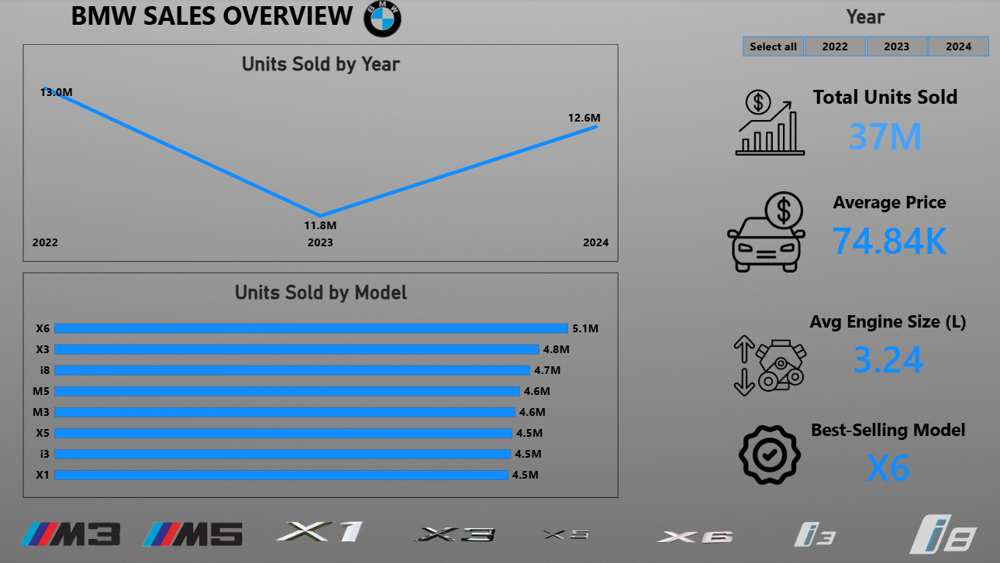
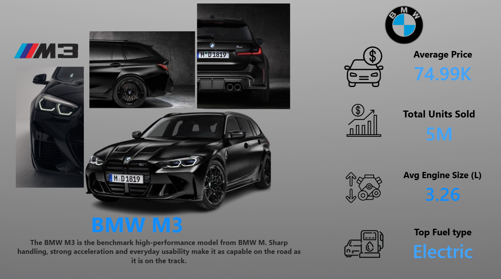
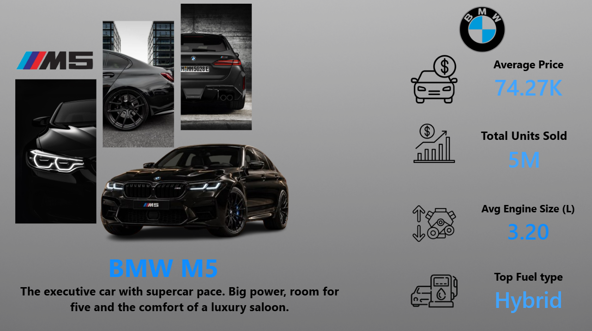
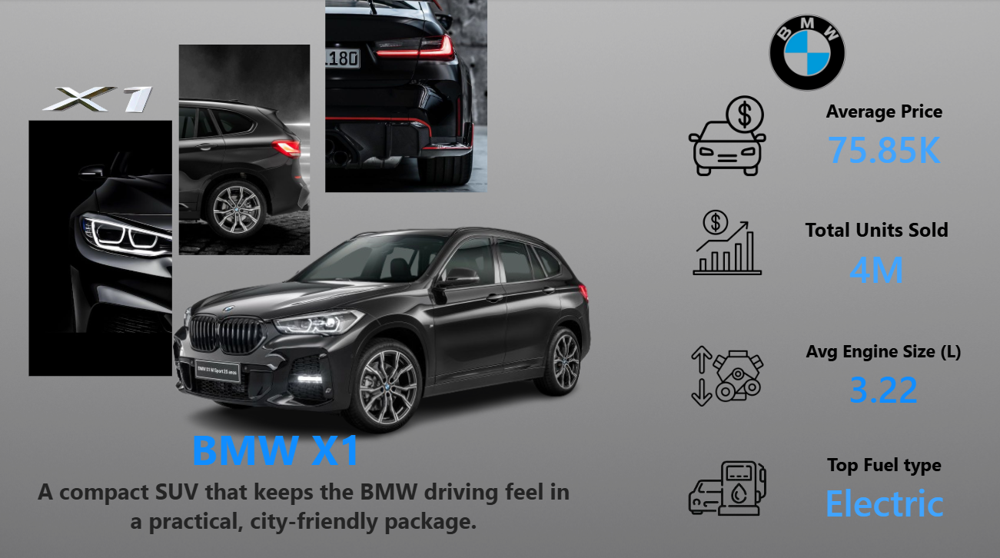
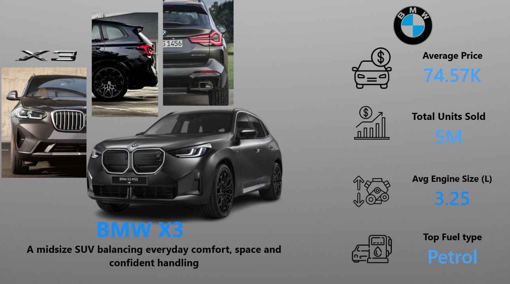
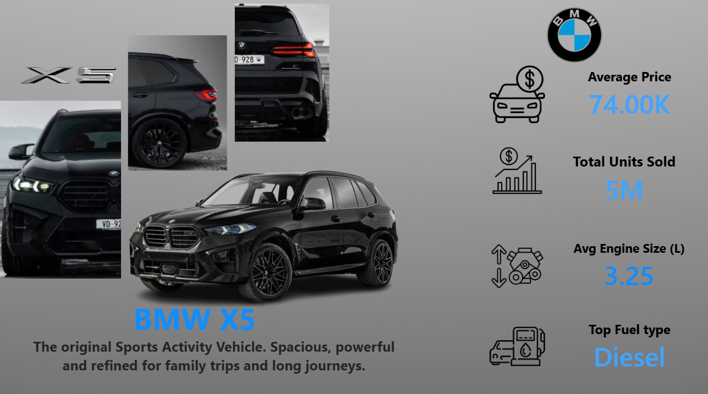
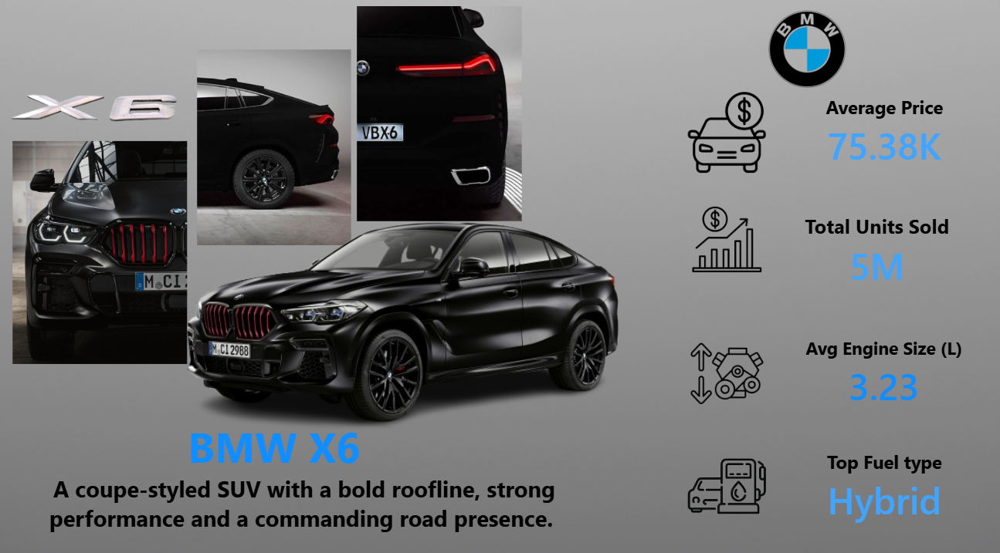
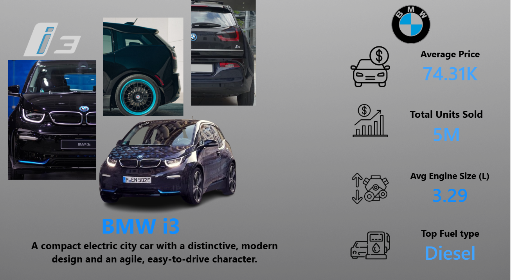
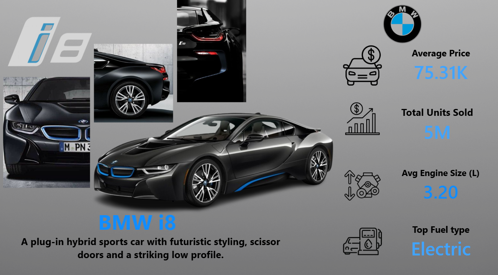

# 🚗 BMW Sales Dashboard | Power BI Portfolio Project

## 1. 📊 Interactive Dashboard Overview

Model pages:

## 2. 📝 Executive Summary & Project Context

An interactive Power BI report with a poster-style design inspired by car posters. It includes an Overview page and 8 dedicated model pages (M3, M5, X1, X3, X5, X6, i3, i8), covering more than 36K sales records from 2022 to 2024.

📈 Core KPIs (Overview page):
* Total Units Sold: ~37 Million
* Average Price: ~$74.84K
* Average Engine Size: 3.24 L
* Best-Selling Model: X6 (5.1M units)

## 3. 🔎 Key Observations

* X6 is the best-selling model (5.1M units), while the lowest models (X1, X5, i3) sell about 4.5M. The gap is around 13%, so sales are spread fairly evenly across models.
* Units sold by year: 13.0M (2022), 11.8M (2023, about -9%), and 12.6M (2024, about +7%).
* Average price per model stays within about 2.5% across all models, so price does not separate the models in this dataset.

⚠️ Note: the dataset is a sample dataset, so these figures are for practice and do not represent real BMW sales.

## 4. 🏗️ Data Model

A Sales table (fact) is linked to a Models table (dimension) through the Model column. The Models table stores the title, description and image links used by each page.

## 5. 🛠️ DAX & Technical Design

* Dynamic measures for the model title, description and images, driven by the selected model
* Sales Units, Top Model and share measures for the KPI cards
* Page navigation buttons linking the Overview to each model page, with a Home button to return
* Custom backgrounds, transparent visuals and consistent icons across all 9 pages

Tools: Power BI, DAX

## 📂 Repository Contents

* PNG files: Screenshots of all dashboard pages.
* `README.md`: Project summary and documentation.

## ⚖️ Disclaimer

Independent portfolio project, not affiliated with BMW. Car photos and logos belong to their owners and are used for demonstration only.
